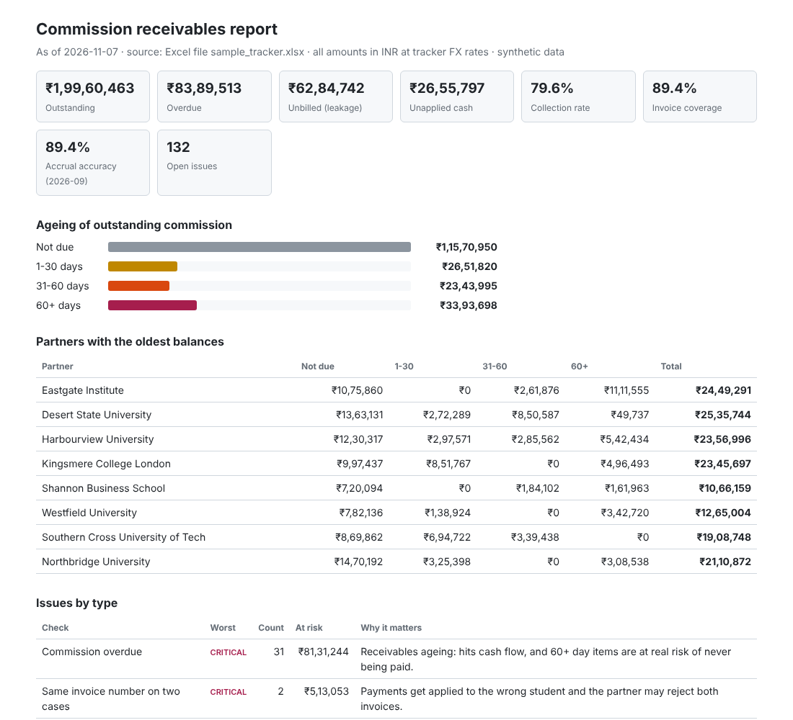

# Ops Sentinel

**Automated monitoring for a commission receivables tracker.** Ops Sentinel reads a spreadsheet tracker (Google Sheets or Excel), reconciles invoices against partner payments, flags revenue leakage and ageing receivables, writes the results back into the same tracker, and lets Claude answer questions about it through an MCP server.

It automates work I do by hand as an operations associate: monthly accruals, multi-currency invoicing to partner universities, and matching what we expected to receive against what actually arrived.

> All data is synthetic. Universities, students, rates and amounts are invented by `ops_sentinel/generate.py`.



---

## The tracker

One spreadsheet, the way an ops team would actually run it:

| Tab | Filled by | Contents |
|---|---|---|
| **Tracker** | Ops (white columns), engine (grey columns) | One row per student: partner, visa status, enrolment, invoice no / date / amount / due date. The engine fills Expected Commission, Received, Outstanding (and INR), Days Overdue, Ageing and Recon Status. |
| **Partners** | Ops | Commission rate and payment terms per university |
| **Remittances** | Ops (from the bank statement) | Payments received, with the invoice reference each one quotes |
| **Accruals** | Finance | Monthly forecast of commission by partner |
| **FX** | Ops | Conversion rates to INR |
| **Issues** | Engine, then people | Everything the checks found. People set Status, Owner and Note; the engine keeps those edits. |
| **KPIs / KPI History** | Engine | Headline numbers, plus one row per day for trends |

## What it checks

| Check | Severity | Why it matters |
|---|---|---|
| Same invoice number on two cases | critical | Payments get applied to the wrong student |
| Enrolled, but not invoiced (21-day SLA) | high | Direct revenue leakage |
| Visa approved, enrolment not confirmed (30 days) | medium | Can't invoice; student may have deferred |
| Commission overdue: 1-30 / 31-60 / 60+ days | medium / high / critical | Receivables ageing and cash flow |
| Short payment | high | Partner paid less than invoiced |
| Small shortfall within tolerance | low | Intermediary bank charges; write off |
| Overpayment / paid twice | high | Needs a refund or credit note |
| Payment with no matching invoice | high | Unapplied cash; its invoice shows as overdue meanwhile |
| Billed at the wrong commission rate | medium | Under-billing loses revenue, over-billing gets disputed |
| Accrual vs actual variance (>25%) | medium | Month-end numbers are off |

Each check is a short SQL query (`ops_sentinel/rules.py`) and every threshold is in one `Config` class.

## How an issue moves

Each issue has a fixed ID (`CHECK:reference`, e.g. `COMMISSION_OVERDUE:INV-KCL-010`), so running the checks again updates issues instead of duplicating them:

* found for the first time → **open**
* someone sets it to **acknowledged** and assigns an owner → kept as is on every run
* the problem is fixed in the tracker → **auto-resolved** on the next run
* someone marks it **resolved** but the tracker still shows the problem → **reopened**

## Asking Claude (MCP)

`ops_sentinel/server.py` exposes the tracker to Claude as MCP tools:

| Tool | What it does |
|---|---|
| `run_checks` | Run every check and write results back to the tracker |
| `get_kpis` | Outstanding, overdue and ageing buckets, unbilled, unapplied cash, collection rate, invoice coverage, accrual accuracy |
| `list_issues` | Filter by severity, check, partner or status |
| `explain_issue` | Why it matters, what to check first, the underlying rows; for unapplied cash, the likely matching invoices |
| `update_issue` | Acknowledge, assign or resolve; saved to the Issues tab |
| `lookup` | One case or invoice end to end |
| `partner_ageing` | Outstanding per partner by ageing bucket |
| `daily_report` | Markdown summary or an HTML report |

Questions it handles: *"What's overdue from UK partners, oldest first?"*, *"Why is INV-KCL-021 flagged?"*, *"Assign the unapplied cash items to Priya."*

## Architecture

```
Google Sheet / Excel ──► sources.py ──► model.py (scratch SQLite copy)
        ▲                                     │
        │                               rules.py (10 SQL checks)
        │                                     │
        └──── engine.py writes back ◄─────────┘
              (tracker columns, Issues, KPIs)
                     │                 │
               server.py (MCP)    report.py (HTML / Markdown)
                     │                 │
                   Claude         cli.py ◄── GitHub Actions (daily)
```

The spreadsheet is the source of truth. The SQLite database is rebuilt in memory on every run, so the checks can be plain SQL.

## Run it

```bash
pip install -e ".[dev]"
python -m ops_sentinel.cli report                 # uses data/sample_tracker.xlsx
pytest -q                                         # 10 tests
python scripts/smoke_mcp.py                       # starts the MCP server and calls its tools
```

Against a Google Sheet (needs a service account key, see `sources.py`):

```bash
export GOOGLE_APPLICATION_CREDENTIALS=~/keys/ops-sentinel.json   # never commit this file
python -m ops_sentinel.cli --source sheets:<spreadsheet id> run
```

Connect to Claude desktop: copy `claude_desktop_config.example.json` into Claude's config, fix the paths, restart Claude.

## Design choices

* **The tracker stays the source of truth.** Ops keeps working in the spreadsheet they already use; the engine only writes its own columns and tabs.
* **Rules are SQL, not ML.** An ops team has to be able to read and tune every check.
* **Severity follows money and age**, not row counts.
* **The issue register is idempotent** and closures are checked against the data, not trusted.
* **One interface, two sources.** Excel for local runs and tests, Google Sheets for live use; nothing else changes.
